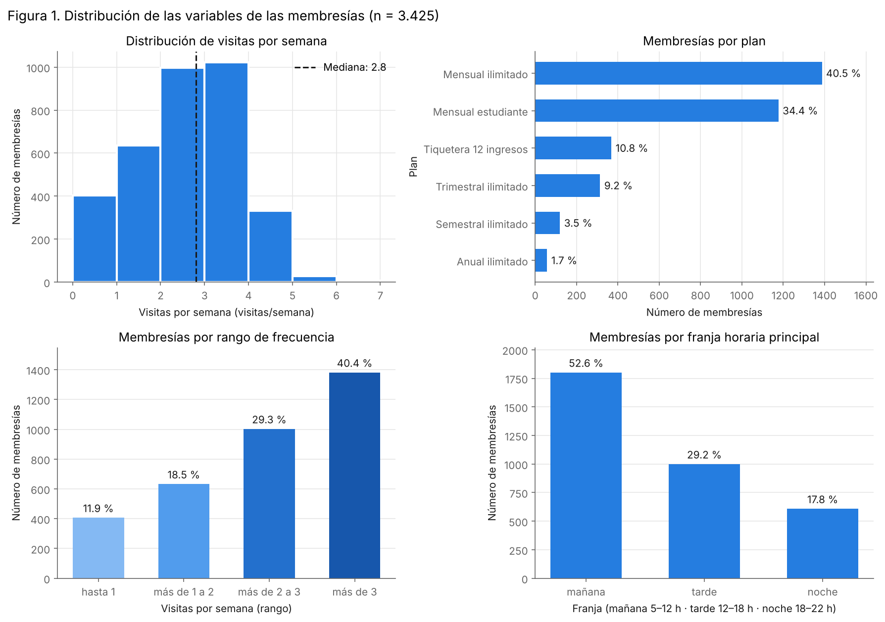
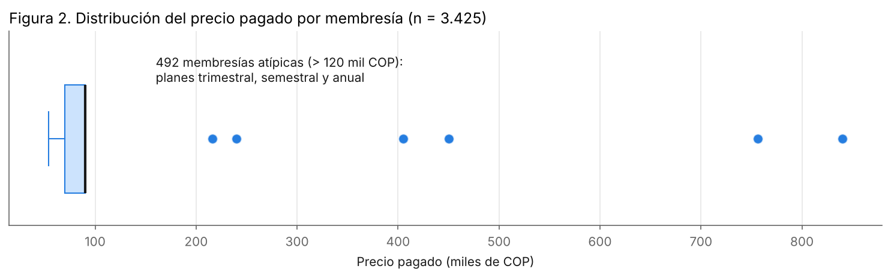
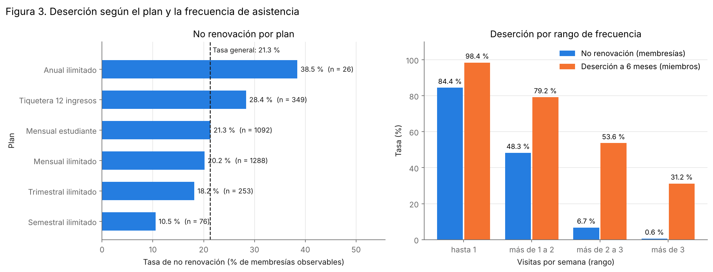
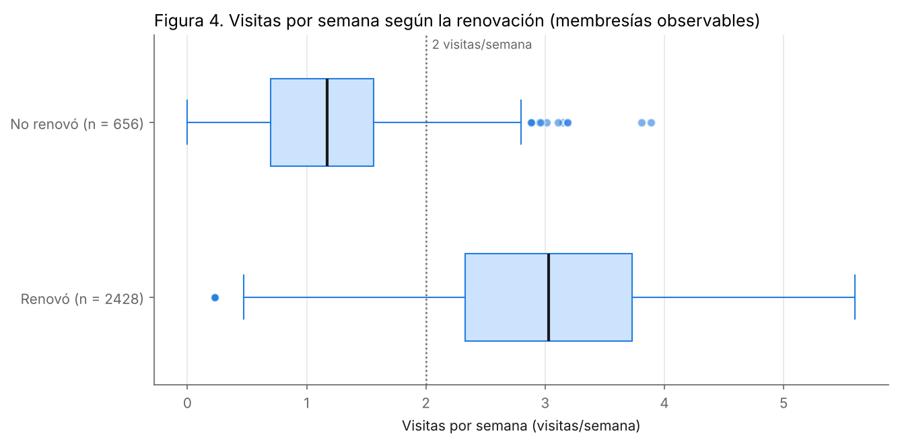
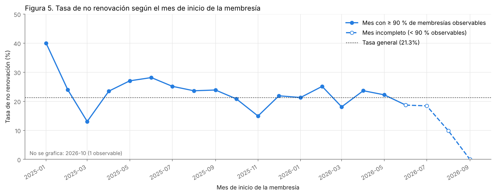
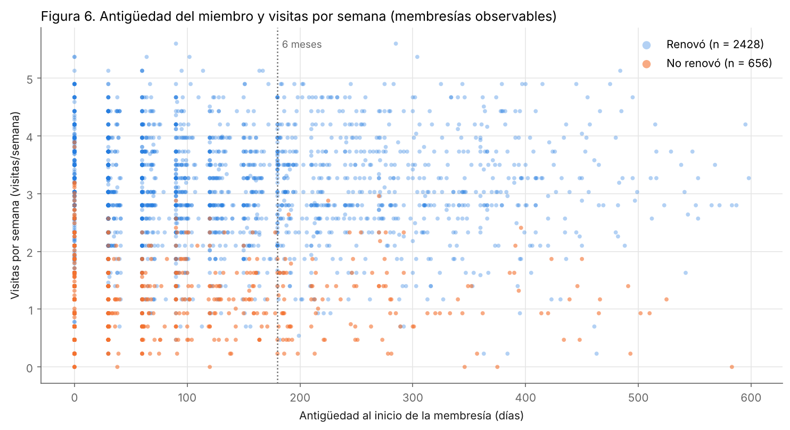

# Informe analítico: deserción de miembros en Zona Fit Evolution

**Evidencia:** GA1-220501094-01-AA1-EV09 – Proyecto final: informe analítico de la idea de proyecto de ciencia de datos con apoyo de inteligencia artificial  
**Aprendiz:** Juan Diego Mejía Llano  
**Programa:** Análisis y Desarrollo de Software (ADSO) – SENA Regional Antioquia, ficha 3223873  
**Fecha:** 27 de noviembre de 2026  
**Repositorio:** https://github.com/juanmejia017/PandasZonafitevolution

Todas las cifras de este informe salen de las salidas de [`notebooks/analytical_report.ipynb`](../notebooks/analytical_report.ipynb), salvo las de la sección 4.3, que salen de los notebooks de calidad (EV06) y preparación (EV07). El uso de inteligencia artificial está documentado en [`prompts.md`](../prompts.md).

---

## 1. Resumen ejecutivo

Zona Fit Evolution quiere saber qué factores llevan a sus miembros a dejar de renovar durante los primeros seis meses. Con 3.425 membresías y 900 miembros simulados (corte al 15/10/2026), el análisis encontró que el **61,10 %** de los miembros evaluables deja de renovar en sus primeros seis meses, aunque cada membresía, vista por separado, se renueva en el 78,73 % de los casos (no renovación del 21,27 %).

El factor más asociado con la deserción es la **frecuencia de asistencia**: la no renovación cae del 84,43 % con hasta 1 visita semanal al 0,57 % con más de 3 (correlación −0,64). Le siguen la **antigüedad**, con el riesgo concentrado en los primeros seis meses (23,85 %, frente al 12,79 % después de un año), y el **tipo de plan**, con la tiquetera en el nivel más alto (28,37 % de no renovación y 74,68 % de deserción a 6 meses). El **horario** influye poco (noche 23,26 %).

Se recomienda: (1) una alerta automática cuando un miembro baje de 2 visitas por semana; (2) un programa de acompañamiento en los primeros seis meses; (3) incentivos para pasar de la tiquetera a planes más largos; y (4) una revisión de la experiencia en la franja nocturna. Los resultados muestran asociaciones, no causas, y deben validarse con datos reales.

## 2. Contexto y pregunta analítica

**Problema.** Zona Fit Evolution es un sistema de gestión para un gimnasio de Medellín (miembros, planes, control de acceso con huella y pagos). Sus ingresos dependen de que los miembros renueven sus membresías. El administrador necesita saber qué caracteriza a los miembros que se van, para actuar a tiempo.

**Propósito.** Identificar los factores asociados con la deserción en los primeros seis meses y proponer acciones de retención basadas en los datos.

**Pregunta analítica.** ¿Qué factores (tipo de plan, frecuencia de asistencia, horario de entrenamiento y antigüedad) influyen en que un miembro de Zona Fit Evolution cancele o no renueve su membresía durante sus primeros seis meses?

**Tipo de análisis.** Descriptivo, con un componente diagnóstico (asociación entre factores y deserción).

**Subpreguntas**

| # | Subpregunta |
|---|---|
| 1 | ¿Cómo varía la deserción según el plan? |
| 2 | ¿Qué relación hay entre la frecuencia semanal de asistencia y la deserción? |
| 3 | ¿La franja horaria se asocia con la deserción? |
| 4 | ¿Cómo cambia el riesgo según la antigüedad y cuántos miembros desertan en sus primeros 6 meses? |
| 5 | ¿Cómo evoluciona la tasa de no renovación según el mes de inicio de la membresía? |

## 3. Metodología

El análisis se hizo en Python con pandas 3 y matplotlib, en un notebook de JupyterLab ejecutable de principio a fin. Se usaron las dos tablas analíticas de la EV07: una por membresía y otra por miembro.

La deserción se midió de dos formas:

- **No renovación por membresía (`no_renovo`):** una membresía no se renueva si fue cancelada o si pasaron más de 30 días desde su fin sin una nueva compra. Se calculó solo con las membresías cuyo resultado ya se conoce al corte (observables).
- **Deserción a 6 meses por miembro (`desertor_6m`):** el miembro dejó de renovar dentro de sus primeros 180 días. Se calculó solo con los miembros que ya cumplieron ese plazo (evaluables).

El análisis univariado incluyó medidas de tendencia central y dispersión (`describe`, cuartiles, rango intercuartílico) y frecuencias absolutas y relativas (`value_counts`). El bivariado comparó las tasas por factor con `groupby`, `agg` y `join`, calculó correlaciones de Pearson y una serie mensual, y detectó atípicos con la regla de Tukey. Las gráficas se eligieron según el tipo de variable (EV08).

**Uso de inteligencia artificial.** Claude (Anthropic, modelo Claude Opus 5.5) apoyó los 11 apartados del proyecto: planteamiento, diccionario de datos, código de carga, análisis y gráficas, redacción y versionamiento. Se aplicaron técnicas como rol, contexto estructurado, few-shot, restricciones, paso a paso, encadenamiento, refinamiento iterativo, generación de alternativas y autoverificación. Cada prompt, la técnica usada y su verificación están en [`prompts.md`](../prompts.md): el código se ejecutó, las cifras se contrastaron con las salidas del notebook y las referencias se comprobaron en sus fuentes. Los errores detectados en las respuestas de la IA (un parámetro obsoleto de matplotlib y autores o títulos inexactos en las referencias) se corrigieron y están registrados en la bitácora.

## 4. Datos

### 4.1 Fuentes y confiabilidad

| Fuente | Contenido | Confiabilidad | Uso |
|---|---|---|---|
| Zona Fit Evolution (simulado) | 5 tablas: planes, miembros, membresías, pagos y accesos del lector de huella (1/1/2025 a 15/10/2026) | Simulada: imita una exportación de la base de datos MySQL del sistema, porque el gimnasio aún no tiene datos reales. Sin datos personales (documento anonimizado). | Base del análisis |
| Kaggle: *Gym customers features and churn* | 4.000 clientes con variable de deserción | Dataset público de terceros, sin documentación oficial de origen | Referencia externa (patrón de frecuencia) |
| Kaggle: *Gym Members Activity Analysis* | 2.600 visitas a gimnasio | Dataset público de terceros | Referencia de asistencia |
| datos.gov.co: escenarios deportivos del INDER Medellín | 1.071 escenarios deportivos públicos | Fuente oficial (Instituto de Deportes y Recreación de Medellín) | Contexto geográfico |

Los datasets externos no se combinan con los de Zona Fit porque no comparten identificadores ni periodo. Este informe se basa en las tablas de Zona Fit.

### 4.2 Diccionario de datos (variables del análisis)

El diccionario completo de las dos tablas (39 y 23 columnas) está en la sección 2 del notebook. Estas son las variables que responden la pregunta:

| Variable | Descripción | Tipo en Pandas | Tipo estadístico | Unidad |
|---|---|---|---|---|
| `nombre_plan` / `tipo_plan` | Plan de la membresía (6 planes; Ilimitado o Tiquetera) | str / category | Cualitativa nominal | — |
| `visitas_semana` | Promedio de visitas por semana durante la vigencia | float64 | Cuantitativa continua | visitas/semana |
| `frecuencia` | Rango de visitas semanales (hasta 1, 1 a 2, 2 a 3, más de 3) | category | Cualitativa ordinal | — |
| `franja_principal` | Franja con más ingresos: mañana, tarde o noche | str | Cualitativa ordinal | — |
| `antiguedad_dias` | Días desde la primera membresía del miembro | int64 | Cuantitativa discreta | días |
| `tramo_antiguedad` | 0 a 6 meses, 6 a 12 meses, más de 12 meses | category | Cualitativa ordinal | — |
| `precio_pagado` | Valor cobrado por la membresía | int64 | Cuantitativa continua | COP |
| `observable` / `no_renovo` | Resultado de renovación conocido / no renovada | bool | Cualitativa nominal | — |
| `evaluable` / `desertor_6m` | Miembro con 6 meses cumplidos / desertó en sus primeros 180 días | bool | Cualitativa nominal | — |

### 4.3 Preparación y limpieza (EV06 y EV07)

El diagnóstico de calidad (EV06, [`reports/data_quality.md`](data_quality.md)) encontró 19 problemas. En la EV07 se corrigieron con un pipeline de funciones de limpieza:

- 93 membresías que seguían `Activa` aunque ya habían vencido: se recalculó su estado con la fecha de fin y la fecha de corte.
- 8 miembros y 12 pagos duplicados, y 675 lecturas dobles del lector de huella: se eliminaron.
- 8 columnas de fecha y el monto de los pagos cargados como texto: se convirtieron a fecha y número.
- Categorías de `genero` escritas de varias formas: se unificaron. Los faltantes de `genero` y `comuna` se marcaron como `Sin dato`.
- 894 accesos inválidos (lecturas dobles, miembros inexistentes, fuera de horario o con membresía cancelada): se excluyeron, y quedaron 56.109 accesos válidos.

Antes de analizar, el notebook comprueba con `assert` que esos problemas ya no existen y que las dos tablas tienen las dimensiones (3.425 × 39 y 900 × 23) y los tipos del diccionario.

## 5. Resultados

### 5.1 Análisis univariado

| Variable | Media | Mediana | Desv. estándar | Q1 | Q3 | Mín. – Máx. |
|---|---:|---:|---:|---:|---:|---|
| Visitas por semana | 2,62 | 2,80 | 1,18 | 1,63 | 3,50 | 0 – 7 |
| Antigüedad (días) | 123,14 | 90 | 133,31 | 0 | 189 | 0 – 634 |
| Edad al inicio (años) | 28,75 | 28 | 8,93 | 22 | 35 | 15 – 58 |
| Precio pagado (COP) | 118.108 | 90.000 | 123.725 | 70.000 | 90.000 | 54.000 – 840.000 |

**Figura 1.** La mayoría de las membresías está entre 2 y 4 visitas semanales (mediana 2,8). Los planes mensuales concentran el 74,86 % de las membresías (Mensual ilimitado 40,50 % y Mensual estudiante 34,36 %), y la tiquetera el 10,77 %. El 40,35 % de las membresías supera las 3 visitas semanales y el 11,88 % tiene 1 visita o menos. La mañana es la franja principal del 52,61 % de las membresías. Además, el 70,74 % de las membresías ocurre en los primeros 6 meses del miembro.

**Figura 2.** El precio típico es de 90.000 COP (mediana), y el 50 % central paga entre 70.000 y 90.000. La media (118.108 COP) está inflada por 492 membresías de planes trimestral, semestral y anual, que aparecen como atípicas pero no son errores.

**Variable objetivo.** De 3.084 membresías observables, el 21,27 % no se renovó. De 671 miembros evaluables, el 61,10 % dejó de renovar en sus primeros seis meses.

### 5.2 Análisis bivariado y por segmentos

**Deserción por plan y por frecuencia**

| Plan | Membresías | No renovación | Miembros | Deserción 6 meses |
|---|---:|---:|---:|---:|
| Tiquetera 12 ingresos | 349 | 28,37 % | 79 | 74,68 % |
| Mensual estudiante | 1.092 | 21,34 % | 221 | 71,04 % |
| Mensual ilimitado | 1.288 | 20,19 % | 240 | 66,67 % |
| Trimestral ilimitado | 253 | 18,18 % | 70 | 41,43 % |
| Semestral ilimitado | 76 | 10,53 % | 34 | 14,71 %* |
| Anual ilimitado | 26 | 38,46 %** | 27 | 0,00 %* |

\* No comparable: un plan de 180 o 365 días casi no puede vencerse sin renovar dentro de los primeros 180 días. \*\* Solo 26 membresías observables.

| Visitas por semana | Membresías | No renovación | Miembros | Deserción 6 meses |
|---|---:|---:|---:|---:|
| Hasta 1 | 366 | 84,43 % | 128 | 98,44 % |
| Más de 1 a 2 | 578 | 48,27 % | 149 | 79,19 % |
| Más de 2 a 3 | 909 | 6,71 % | 192 | 53,65 % |
| Más de 3 | 1.231 | 0,57 % | 202 | 31,19 % |

**Figura 3.** La tiquetera es el plan con más no renovación entre los que tienen suficientes casos. La frecuencia muestra la relación más fuerte del análisis: las dos tasas bajan de forma escalonada al aumentar las visitas.

**Figura 4.** Las membresías que no se renovaron tienen una mediana de 1,17 visitas por semana (50 % central entre 0,70 y 1,56); las renovadas, 3,03 (entre 2,33 y 3,73). La línea de 2 visitas por semana separa casi por completo los dos grupos.

**Franja horaria.** La no renovación es del 20,85 % en la mañana, 20,04 % en la tarde y 23,26 % en la noche. Quienes empiezan de noche desertan más a 6 meses (67,80 %, frente a cerca del 59,5 % en mañana y tarde). Se excluyeron 9 membresías observables sin visitas.

**Antigüedad.** La no renovación es del 23,85 % en los primeros 6 meses del miembro, 14,44 % entre 6 y 12 meses y 12,79 % después de un año. La correlación de Pearson con `no_renovo` es −0,64 para `visitas_semana` y −0,14 para `antiguedad_dias`.

**Figura 5.** En los meses con resultado conocido la tasa oscila alrededor de la tasa general (21,3 %), entre el 13 % y el 28 % desde febrero de 2025, salvo el 40 % de enero de 2025 (primer mes del periodo, solo miembros nuevos). La caída final no es una mejora: son meses cuyas membresías aún no terminan al corte (septiembre de 2026: 32,52 % observables).

**Figura 6.** Las membresías no renovadas (naranja) se concentran por debajo de 2 visitas por semana en cualquier antigüedad, y la mayoría de los puntos está antes de los 6 meses. La frontera entre renovar o no la marca más la frecuencia que la antigüedad.

**Valores atípicos.** Solo 8 de 3.425 membresías (0,23 %) son atípicas en visitas por semana (7 visitas): empezaron entre uno y tres días antes del corte, ninguna es observable y quitarlas casi no cambia la media (2,62 frente a 2,61).

## 6. Respuesta a la pregunta analítica y hallazgos clave

**Respuesta.** Los cuatro factores se asocian con la deserción, pero con distinta fuerza. El más determinante es la **frecuencia de asistencia**: la no renovación cae del 84,43 % con hasta 1 visita semanal al 0,57 % con más de 3 (correlación −0,64). Le sigue la **antigüedad**: el riesgo se concentra en los primeros seis meses (23,85 %, frente al 12,79 % después de un año), y en ese periodo el 61,10 % de los miembros evaluables deja de renovar. El **tipo de plan** también influye: la tiquetera tiene la mayor no renovación (28,37 %) y la mayor deserción temprana (74,68 %). El **horario** pesa poco; solo la noche queda algo por encima (23,26 %).

| # | Hallazgo | Evidencia | Implicación |
|---|---|---|---|
| 1 | La frecuencia de asistencia es el factor más asociado con la deserción. | No renovación del 84,43 % (hasta 1 visita) al 0,57 % (más de 3); deserción a 6 meses del 98,44 % al 31,19 %; correlación −0,64. | El número de visitas es la señal temprana más útil; 2 visitas por semana es un umbral práctico. |
| 2 | Los primeros seis meses son el periodo crítico. | 61,10 % de deserción a 6 meses; no renovación del 23,85 % en ese tramo frente al 12,79 % después de un año. | La retención se gana o se pierde al inicio. |
| 3 | Los planes cortos, en especial la tiquetera, concentran el riesgo. | Tiquetera: 28,37 % y 74,68 %; ilimitados: 20,37 % y 59,29 %. | El plan sirve para segmentar el seguimiento; la mejor retención de los planes largos puede deberse a autoselección. |
| 4 | El horario influye poco. | Mañana 20,85 %, tarde 20,04 %, noche 23,26 %. | No justifica acciones grandes, pero la franja nocturna merece revisión. |

## 7. Recomendaciones

| Recomendación | Hallazgo | Indicador para medirla |
|---|---|---|
| **Alerta de baja asistencia:** con los registros del lector de huella, marcar a los miembros que bajen de 2 visitas por semana y contactarlos (entrenador, clase, ajuste de rutina). | 1 | Tasa de no renovación de los miembros alertados y contactados frente a los no contactados |
| **Acompañamiento en los primeros seis meses:** valoración inicial, plan de entrenamiento y seguimientos programados. | 2 | Deserción a 6 meses de las nuevas cohortes frente a la línea base del 61,10 % |
| **Migración de la tiquetera:** incentivo para pasar a un plan ilimitado o trimestral al terminar la tiquetera o el primer mes. | 3 | Porcentaje de tiqueteras que renuevan en otro plan; no renovación de la tiquetera frente al 28,37 % |
| **Revisión de la experiencia nocturna:** encuesta corta sobre máquinas, acompañamiento y seguridad antes de invertir. | 4 | Deserción a 6 meses de quienes empiezan de noche frente al 67,80 % |

## 8. Limitaciones y próximos pasos

**Limitaciones**

- **Calidad y origen de los datos:** son simulados; las conclusiones deben validarse con la operación real del gimnasio.
- **Alcance del análisis:** muestra asociaciones, no causas. La relación entre frecuencia y deserción puede ir en los dos sentidos: quien ya piensa retirarse deja de ir.
- **Variables faltantes:** solo se registra la entrada al gimnasio (no la salida ni la duración) y no se conoce el motivo del retiro.
- **Periodo y cobertura:** el periodo cubre unos 21 meses, y los meses cercanos al corte (15/10/2026) tienen resultados incompletos.
- **Tamaño de algunos grupos:** el plan anual tiene solo 26 membresías observables, y la deserción a 6 meses de los planes largos no es comparable con la de los cortos.

**Próximos pasos**

1. Repetir el análisis con datos reales cuando el sistema esté en operación.
2. Registrar el motivo de retiro con una encuesta de salida.
3. Probar formalmente las diferencias entre grupos (por ejemplo, chi-cuadrado entre plan y no renovación) y construir un modelo predictivo de riesgo de deserción.

## 9. Referencias

adrianvinueza. (s. f.). *Gym customers features and churn* [Conjunto de datos]. Kaggle. Recuperado el 27 de noviembre de 2026, de https://www.kaggle.com/datasets/adrianvinueza/gym-customers-features-and-churn

anetakowalik. (s. f.). *Gym members activity analysis* [Conjunto de datos]. Kaggle. Recuperado el 27 de noviembre de 2026, de https://www.kaggle.com/datasets/anetakowalik/gym-members-activity-analysis

Anthropic. (2026). *Claude* (versión Claude Opus 5.5) [Modelo de lenguaje de gran tamaño]. https://claude.ai

Hunter, J. D. (2007). Matplotlib: A 2D graphics environment. *Computing in Science & Engineering, 9*(3), 90–95. https://doi.org/10.1109/MCSE.2007.55

Instituto de Deportes y Recreación de Medellín. (2021). *Escenarios deportivos INSTITUTO DE DEPORTES Y RECREACIÓN DE MEDELLÍN – INDER* [Conjunto de datos]. Portal de Datos Abiertos de Colombia. Recuperado el 27 de noviembre de 2026, de https://www.datos.gov.co/Deporte-y-Recreaci-n/Escenarios-Deportivos-INSTITUTO-DE-DEPORTES-Y-RECR/i5z5-qhf8

McKinney, W. (2010). Data structures for statistical computing in Python. En S. van der Walt y J. Millman (Eds.), *Proceedings of the 9th Python in Science Conference* (pp. 56–61). https://doi.org/10.25080/Majora-92bf1922-00a

The pandas development team. (2026). *pandas-dev/pandas: Pandas* (versión 3.0.6) [Software]. Zenodo. https://doi.org/10.5281/zenodo.3509134
